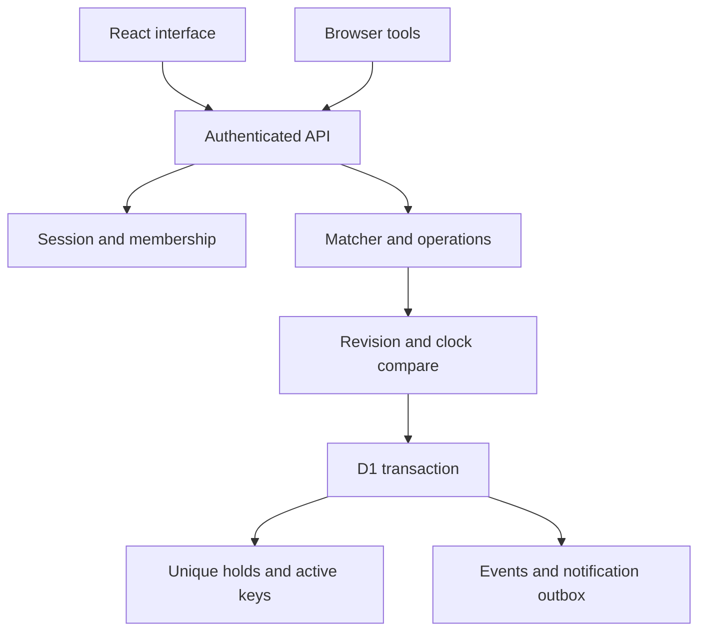

# Architecture

## Runtime and boundaries

Vinext implements the Next-style app/router API on Workers. React components call one catch-all API route. The domain matcher and operation reducer are pure TypeScript; neither trusts a browser's actor ID. D1 stores a revisioned community aggregate plus relational integrity projections.

## Source map

| Path | Responsibility |
|---|---|
| `domain/types.ts`, `seed.ts` | Contracts and guarded synthetic dataset |
| `domain/matching.ts` | Eligibility, directed cycles, scheduling, ranking |
| `domain/operations.ts` | Validated mutations, state transitions and reconciliation |
| `server/storage.ts` | Raw D1 reads, hashing, capacity, compare-and-swap commits/retries |
| `server/auth.ts` | Hashed demo sessions; Sites identity-to-membership mapping |
| `server/dto.ts` | Member-safe read responses |
| `server/photos.ts`, `photo-body.ts`, `photo-storage.ts`, `image-validation.ts` | Bounded JPEG upload, independent pixel validation, private reads, durable upload claims and cleanup |
| `app/api/[...path]/route.ts` | Authorization, origin/body limits, typed routes and errors |
| `components/loopswap-app.tsx`, `loopswap-forms.tsx` | Real journeys and server refresh |
| `components/loopswap-loans.tsx` | Frozen loan review, pickup/return workflow, role-specific assessments and venue calendars |
| `components/app-link.tsx`, `lib/app-navigation.ts`, `lib/app-query.ts` | Native anchors, same-origin imperative navigation and URL-backed filters |
| `components/listing-photo.tsx`, `lib/prepare-photo.ts` | Optional one-photo editor, local preparation and identical-body upload retry |
| `components/maintenance.tsx` | Moderator readiness and bounded unused-photo cleanup controls |
| `components/webmcp-bridge.tsx` | Feature-detected page-scoped tools using the same API/actions |
| `lib/time.ts` | Temporal timezone conversion with ambiguous/nonexistent time rejection |
| `db/schema.ts`, `drizzle/` | Aggregate, trade/loan projections, upload records, append-only migrations and integrity triggers |

## Reads and writes

A member read resolves identity, loads the stored revision and database `unixepoch()`, reconciles deadlines if necessary, and returns an authorized DTO. Full schedules, blocks, private reports, identity mappings, and other members' notifications are not public. Ordinary participant events omit sensitive audit actor/kind/operation metadata.

A mutation validates a UUID idempotency key, current membership, operation authority, and schema. It computes the new aggregate outside database locks. One conditional UPDATE matches the revision and the database second from the snapshot. Triggers validate the ledger and project every hold, audit event, and outbox row within that same transaction. A conflict reloads/recomputes, at most three attempts. No network call occurs inside the database transaction.

The client keeps request keys after uncertain network failures. Once the write is known to have committed, a failed refresh displays a saved-action/retry banner and still returns success; it does not resubmit the creation. A visible signed-in page polls every five seconds and refreshes on reconnect and restored browser pages. Request sequencing prevents an older bootstrap response from overwriting newer state. This is polling, not a realtime subscription.

Page links use native anchors. Imperative navigation resolves an HTTP(S) destination against the current origin and rejects other origins before using `window.location.assign`. These journeys do not depend on framework RSC/prefetch transitions. Browse filters live in query parameters, and item-specific trade links select the requested eligible offer. Matching inputs have a server-derived change token so client results can be refreshed when relevant state changes.

Loan request review captures a cloned listing and its version before loading pickup options. Polling does not silently replace reviewed terms. A changed item or hold disables submission until the member reviews the latest offer, and changing an appointment clears the acceptance checkbox. Dialog actions retain the sequence or action the member opened, with server conflict checks remaining authoritative.

## Auth and deployment assumptions

Demo mode requires **both** a demo runtime flag and a demo stored community. Cookies contain random nonces; D1 stores SHA-256 hashes with eight-hour expiry. Demo sign-in is unavailable in pilot mode. Demo users and moderator are deliberately fictional.

Pilot mode uses the Sites SIWC dispatch identity plus operator-provisioned `platform_identities` and active membership. Bootstrap distinguishes anonymous, active, awaiting-membership, suspended, and left states; inactive access shows its status without granting private records or mutations. The deployment must remain behind the trusted Sites dispatch boundary, which controls authenticated headers. A standalone Worker trusting caller-supplied identity headers is not an approved pilot deployment. Provisioning new real members and verifying the hosted identity path remain release work.

The requested Supabase/PostgreSQL backend was unavailable in this workspace. D1 has no RLS or authenticated SQL roles; privileged Worker code owns authorization. SQLite triggers provide integrity checks, not a substitute for PostgreSQL RLS. There is one community, selected by the server, rather than a multi-community client selector.

## Jobs and storage

`POST /api/jobs/reconcile` requires a server bearer secret. It reconciles deadlines, removes expired demo sessions, and runs bounded unused-photo cleanup. The same deadline reconciliation runs on authenticated reads and mutations, so late accepts cannot bypass deadlines even if a job is delayed. An actual minute scheduler and its secret remain external pilot setup. In-app notification/outbox records are transactional; no email/push channel exists.

Static generated WebP examples ship with the app. Optional uploaded item photos use a private R2 binding and D1 `photo_uploads` records. Browser JPG/PNG/WebP preparation is followed by independent bounded JPEG decoding and metadata-free re-encoding on the server. Authenticated reads authorize the owner, moderator, visible listing reader, or historical agreement participant. Upload tombstones and SQL reference guards make retries and cleanup durable across separate object-store/database operations; these operations are not one cross-service transaction. See [security/privacy](SECURITY_PRIVACY.md) for limits and [operations](OPERATIONS.md) for cleanup.

`GET /api/health` performs a database schema query. Moderator-only maintenance reports aggregate size, holds, review cases, photo binding availability, and whether job authentication is configured. Neither reports a verified scheduler, restore, retention service, or pilot approval. The aggregate is intentionally bounded; ordinary activity stops above 600 KB and handoff/review recovery can use reserved capacity up to 1.4 MB, with a database UTF-8 limit of 1.5 MB. Automated history archival remains unimplemented.

## Trade and lending release

The app now supports trade/lend/both listing modes, one-item loans with independent pickup and return acknowledgments, shared trade/loan reservations, moderator custody cases, and role-specific participant assessments. See [Loans and reliability](LOANS_REPUTATION.md) for the state machine, data and transaction rules, scoring weights, privacy, operator calendar workflow, and remaining pilot gates. The older trade-only descriptions above apply to the existing loop subsystem.
