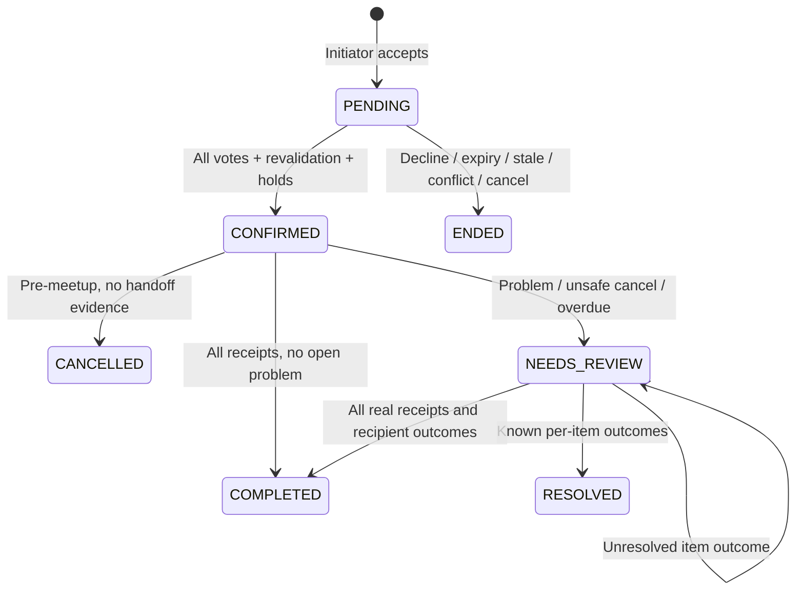

# Transactions

## State machine

`ENDED` groups distinct persisted terminal states; it is not a stored enum. Blocks or suspension can also stale pending proposals or send confirmed exchanges to review.

## Atomic commit protocol

1. Read `state`, `revision`, and `unixepoch()` together from D1.
2. Resolve and authorize the current actor before replaying any cached request.
3. Reconcile expiry/overdue conditions; validate and compute the operation outside locks.
4. Append its event/notifications and recent idempotency result to the proposed state.
5. Execute one conditional UPDATE matching the previous revision **and database second**.
6. In that transaction, triggers validate all invariants and synchronize every relational hold, active key, audit row and outbox row.

SQLite serializes this write; there is no per-item PostgreSQL lock order. A lost revision/clock comparison reloads and recomputes, at most three attempts. A trigger failure rolls back the whole UPDATE and every projection. No reservation work, network call, or notification send occurs in a separate partial transaction.

## Proposal and confirmation

Creation checks active membership, actual graph/rules, immutable input versions, exact shared slot, two-hour lead, duplicate key, rolling limits and decline cooldown. The initiator's acceptance belongs to that proposal's immutable terms. Pending proposals create **zero holds**.

The final voter must be a pending participant before the database deadline. Response deadline is `min(created+24h, meetupStart−1h)`. Final acceptance rechecks all material versions, membership, blocks, rules, approved venue/time and item/member availability. It then records CONFIRMED and all reserved item states. Unique item and participant keys project all holds or none. A competing commit leads to CONFLICTED or a retryable result; it cannot reserve a subset.

## Receipts and completion

Only the intended recipient may record a transfer receipt, from meetup start minus ten minutes. A receipt cannot be edited or replaced. A duplicate receipt returns the current state without another event. The authoritative database clock controls the gate.

If the loop is CONFIRMED, every transfer has a receipt, and no report remains open, the same commit records COMPLETED, marks every listing exchanged, and releases every item/member hold. A receipt during NEEDS_REVIEW is evidence; it does not automatically override the review.

## Cancellation and review

A pending participant can end the unreserved proposal. A confirmed loop can cancel and release holds only before meetup start, with no receipt and no problem record. Otherwise cancellation enters NEEDS_REVIEW and keeps all holds. Inactive owners' returned availability is paused, not reactivated.

After meetup end plus two hours, missing receipts cause review; expiry never releases uncertain physical-transfer holds. A moderator supplies one explicit outcome per item and an evidence reason, checked against current terms version and **sequence**. Any unresolved outcome retains all holds. Known outcomes close reports and release holds: recipient items become exchanged; original-owner items become paused. Original-owner republication changes the current listing while leaving the historical resolution untouched. No moderator action creates a participant receipt.

## Idempotency and recovery

Keys are UUIDs scoped to actor+operation for 48 hours. Canonical JSON-body hashes make equivalent object property order replay safely; changing a body under the same key is a 409 conflict. Authorization precedes replay so a revoked membership cannot use cached success as access. The stored result is committed with the operation. Expired keys are pruned by reconciliation.

The UI retains keys for uncertain transport failures. A known committed write followed by refresh failure stays a successful write and offers a view refresh. After reload/reconnect, server state is authoritative; browser state is not a ledger. The configured capacity budget refuses new ordinary activity before handoff/review recovery capacity is exhausted.

Loan request and decision dialogs retain the reviewed version/sequence instead of silently moving consent to new terms. Native anchors and validated same-origin action navigation load the destination through the browser; URL filters remain shareable and reloadable. Neither navigation nor the browser cache changes the authoritative agreement ledger.

## Private photo claims and cleanup

Photo upload uses a separate actor-owned UUID claim in D1 before writing the private object. Input hashes, ownership, upload state, and rolling quota are checked independently of the community JSON write. Attaching a new photo requires an owned ready upload; SQL guards protect listing ownership and all current or historical listing/loop/loan references. Object storage and D1 do not form one atomic transaction.

Unused uploads older than 24 hours are processed in bounded batches of 100. Staged, ready, deleting, and deleted states retain durable tombstones; interrupted deletion can retry, and deleted tombstones are re-swept after 24 hours to repair a late interrupted upload. Repeated safe deletes are idempotent, so the maintenance result counts cleanup records processed rather than necessarily distinct objects removed. Referenced photos and tombstone records are retained. See [Operations](OPERATIONS.md) for the externally scheduled job and manual moderator path.

## Proofs run

Real SQLite tests inject failures during reservation and final-receipt hold release, then compare persisted state, both hold tables, events and outbox. A barrier synchronizes two independent SQLite connections reading the same revision; at most one competing confirmation commits, then the loser recomputes CONFLICTED. Compiled Worker tests also issue concurrent actual D1 HTTP confirmations. These are model-specific SQLite/D1 proofs, not unrun PostgreSQL claims.

## Trade and lending release

The app now supports trade/lend/both listing modes, one-item loans with independent pickup and return acknowledgments, shared trade/loan reservations, moderator custody cases, and role-specific participant assessments. See [Loans and reliability](LOANS_REPUTATION.md) for the state machine, data and transaction rules, scoring weights, privacy, operator calendar workflow, and remaining pilot gates. The older trade-only descriptions above apply to the existing loop subsystem.
